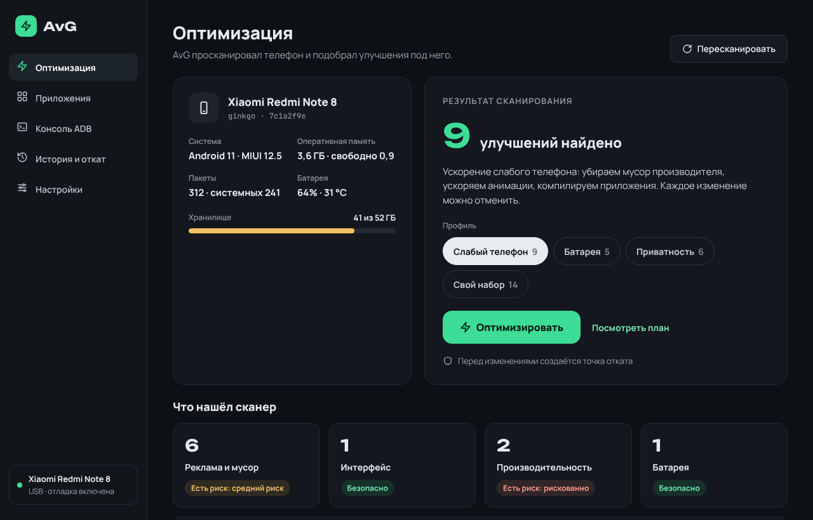
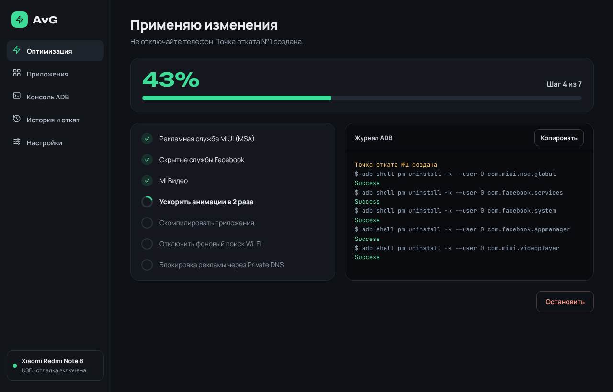
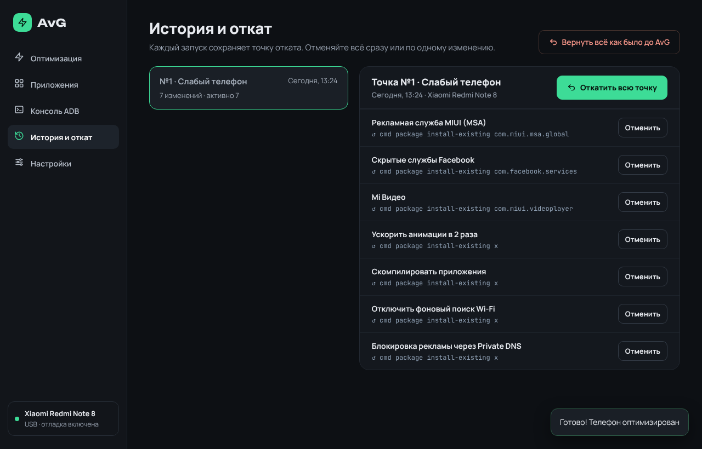
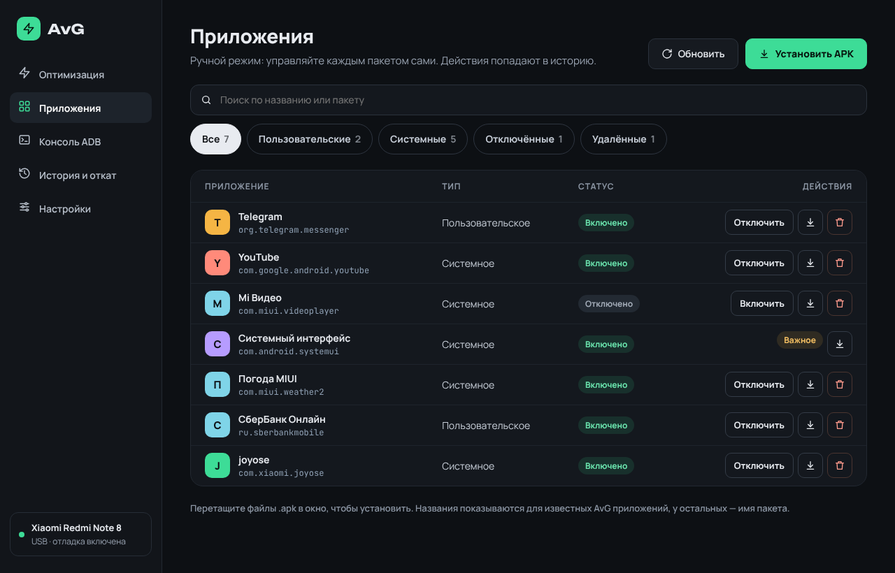

<div align="center">


# AvG

**Оптимизатор Android в один клик.** Подключите телефон по USB — AvG просканирует его,
подберёт безопасные улучшения под конкретную модель и применит их через ADB.
Любое изменение можно отменить.

Без root · без установки чего-либо на телефон · с открытым кодом (GPL-3.0)

[](https://github.com/DezFix/AvG/actions/workflows/ci.yml)
[](https://github.com/DezFix/AvG/releases)
[](LICENSE)

</div>



## Что умеет

- **Сканирование.** Модель, прошивка (MIUI / HyperOS / One UI / ColorOS), память, батарея, все пакеты.
- **Профили оптимизации:**
  - «Слабый телефон»: убрать мусор производителя, ускорить анимации, скомпилировать приложения;
  - «Батарея»: меньше фоновых служб и поиска сетей;
  - «Приватность»: убрать аналитику и рекламу, блокировать трекеры через Private DNS;
  - «Свой набор»: всё, что подходит телефону.
- **Понятный план.** Перед применением видно каждое изменение: что делает, уровень риска, какие команды выполнятся. Рискованное по умолчанию не выбрано.
- **Откат.** Перед каждым изменением AvG запоминает, как его отменить. Отменить можно одно изменение, весь запуск или вообще всё, что делал AvG на этом телефоне.
- **Ручной режим.** Список приложений с поиском и фильтрами:
  - отключение, удаление и восстановление;
  - сохранение APK на компьютер;
  - иконки и настоящие названия приложений, прочитанные из APK на телефоне;
  - оценка «можно ли удалить» для каждого пакета.
- **Мультиустановщик.** Соберите свои APK в одну папку: AvG покажет, что уже стоит на телефоне, что обновится, а что не подойдёт, и установит выбранное по очереди. Понимает наборы `.apks`, `.xapk` и `.apkm` (ставит нужные части для процессора телефона и копирует данные игр).
- **Консоль ADB** для своих команд.
- **Твики в файлах.** Набор оптимизаций описан в простых TOML-файлах, его легко дополнять без знания Rust (см. [docs/TWEAKS.md](docs/TWEAKS.md)).

| План и применение | История и откат | Приложения |
|---|---|---|
|  |  |  |

## Как пользоваться

1. Скачайте AvG из раздела [Releases](https://github.com/DezFix/AvG/releases).
2. Запустите AvG. adb ставить вручную не нужно: при первом запуске программа сама ищет его на компьютере. Она проверяет Android SDK, Chocolatey, Scoop, WinGet и эмуляторы Nox, MuMu, LDPlayer, BlueStacks, MEmu и Genymotion, а затем просматривает диски. Если adb не найдётся, нажмите **«Скачать adb»**: AvG скачает официальный пакет SDK Platform-Tools с dl.google.com (около 7 МБ) в свою папку данных. Путь можно указать и вручную в настройках.
3. Включите на телефоне отладку по USB:
   - **Настройки → О телефоне** → 7 раз нажмите «Номер сборки». На Xiaomi нажимайте «Версия MIUI/HyperOS».
   - **Настройки → Для разработчиков** → включите «Отладка по USB». На Xiaomi включите ещё «Отладка по USB (настройки безопасности)».
4. Подключите телефон кабелем и разрешите отладку во всплывающем окне на телефоне.
5. Выберите профиль и нажмите **«Оптимизировать»**.

### Насколько это безопасно

- Приложения удаляются командой `pm uninstall -k --user 0`. Это удаление *для пользователя*: сам APK остаётся в системном разделе. Его можно вернуть из «Истории и отката», а после сброса к заводским настройкам всё вернётся само.
- Системно важные пакеты (интерфейс, настройки, телефония, сервисы Google и т.п.) в ручном режиме защищены от удаления и отключения.
- Всё, что подставляется в команды, проверяется на допустимые символы.
- Программа распространяется **без каких-либо гарантий**. Изменения обратимы, но ответственность за телефон на вас.

## Сборка из исходников

Понадобятся [Rust](https://rustup.rs) (stable) и системные зависимости Tauri 2:

- **Windows:** Microsoft C++ Build Tools и WebView2. WebView2 уже есть в Windows 10/11.
- **Linux:** `libwebkit2gtk-4.1-dev libgtk-3-dev librsvg2-dev libayatana-appindicator3-dev`.
- **macOS:** Xcode Command Line Tools.

Подробнее: <https://tauri.app/start/prerequisites/>

```bash
# запуск в режиме разработки
cargo run -p avg

# тесты ядра (телефон не нужен)
cargo test -p avg-core

# установщик (.msi / .exe, .deb / .AppImage, .dmg)
cargo install tauri-cli --version "^2" --locked
cargo tauri build
```

Интерфейс написан на чистом HTML/CSS/JS без сборщика, поэтому Node.js не нужен. Над дизайном можно работать без телефона: запустите любой локальный сервер в папке `ui` (например, `python -m http.server`) и откройте страницу в браузере. Включится демо-режим с тестовыми данными.

Релизы для Windows, Linux и macOS собирает GitHub Actions при пуше тега `v*`, см. `.github/workflows/release.yml`.

## Структура проекта

```
crates/avg-core/   ядро на Rust: adb, сканирование, план, применение, откат (покрыто тестами)
src-tauri/         приложение Tauri: команды для интерфейса, окно, установщик
ui/                интерфейс (HTML/CSS/JS), шрифты
tweaks/            наборы твиков в TOML — встраиваются в программу при сборке
design/mockup/     исходный макет интерфейса
docs/              документация и скриншоты
```

## Как помочь

Самая полезная помощь — новые твики для вашего телефона. Опишите их в TOML по [инструкции](docs/TWEAKS.md) и пришлите pull request. Укажите, на какой модели и прошивке проверяли.

## Лицензия

AvG — свободная программа: вы можете распространять и изменять её на условиях
[GNU General Public License v3.0](LICENSE) или (по вашему выбору) любой более поздней версии.

Используемые компоненты:
- шрифты Manrope, Unbounded и JetBrains Mono (SIL Open Font License 1.1, файлы лицензий в `ui/fonts`);
- [Tauri](https://tauri.app) (MIT/Apache-2.0).

Android Platform-Tools в репозиторий не входят и распространяются Google на собственных условиях.
